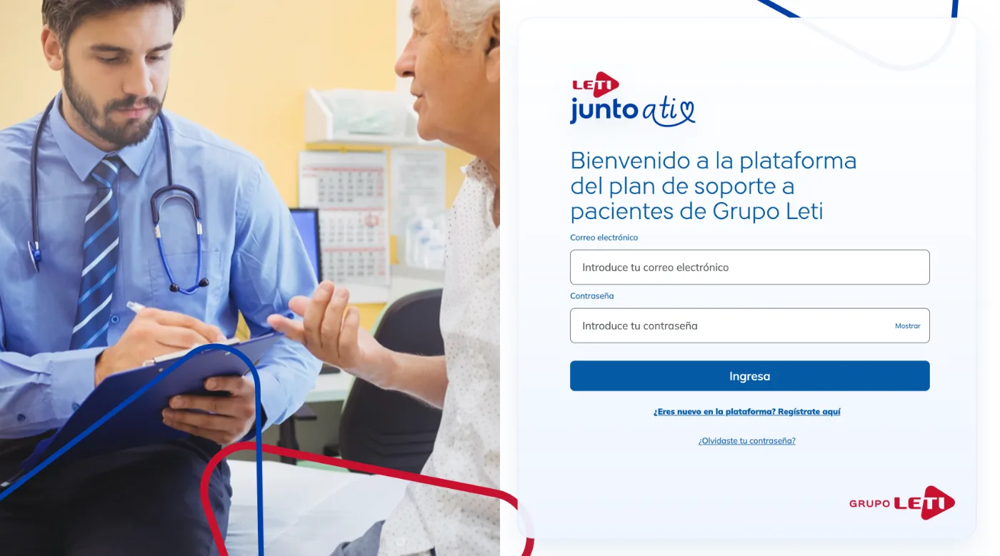
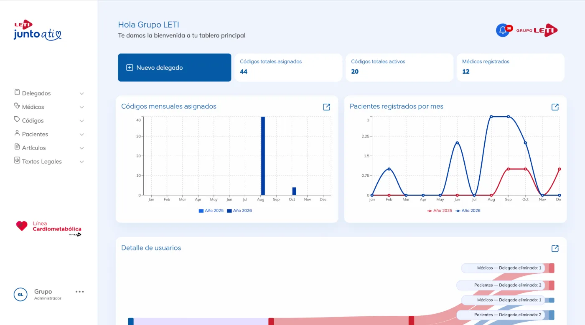
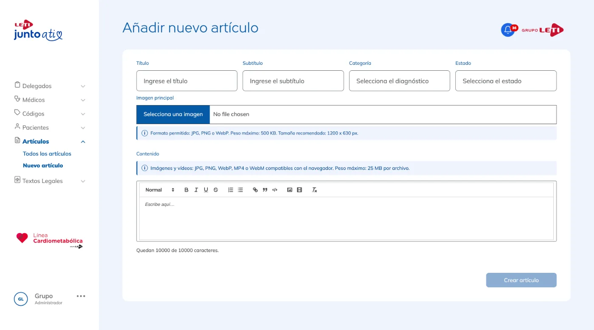

# Leti Junto a Ti — Patient support platform (PSP)

Full-stack web platform for **Leti Junto a Ti**, the patient support program of **Grupo Leti**'s cardiometabolic line, with three role-based portals: **Admin**, **Patient** and **Delegate**.

> The source code is private (client project). This repository is a case study.

## My role

Full-stack development (front-end and API) and UI/UX improvements.

## Highlights

- Role-based dashboards with charts, date-range filtering and Excel export
- Management of delegates, doctors, patients and activation codes
- Article editor with rich text, images and video, plus legal texts management
- Notifications
- Security-first API: argon2 password hashing, encrypted user data, hardened sessions and HTTP headers, and an automated security test suite covering authorization, registration, account flows and response filtering

### Admin dashboard

### Article editor

## Stack

React 19 · React Router · Recharts · Quill · Bootstrap · Node 22 · Express · MongoDB / Mongoose · Firebase Hosting
